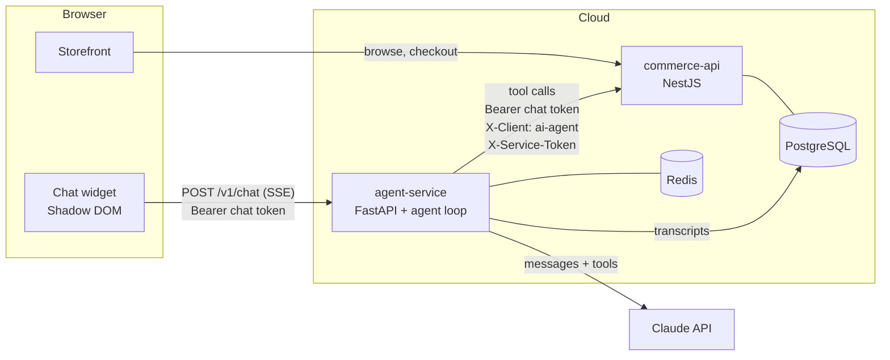
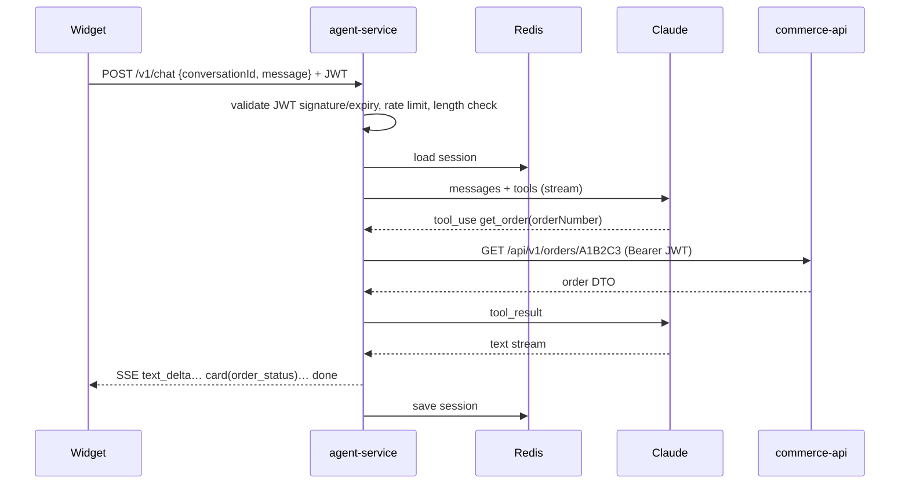
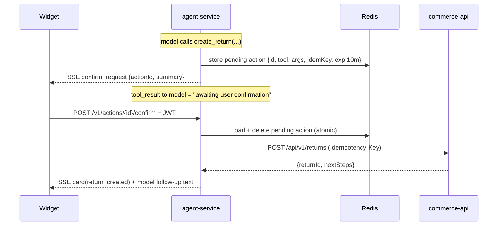

# Architecture — AI Shopping Assistant

| | |
|---|---|
| Last updated | 2026-11-08 |
| Short version | [ARCHITECTURE-ESSENTIAL.md](./ARCHITECTURE-ESSENTIAL.md) |
| Agent details | [AGENT.md](./AGENT.md) |

## 1. Overview

Three deployable parts plus two data stores:

| Part | Tech | State | Responsibility |
|---|---|---|---|
| `commerce-api/` | NestJS 11, TypeORM, PostgreSQL | **Built** | Source of truth: users, catalog, cart, orders, returns, FAQ, tickets, agent audit log |
| `agent-service/` | Python 3.12, FastAPI, Anthropic SDK, httpx, Redis | **To build** | LLM loop, tools, confirmation gate, sessions, guardrails, SSE streaming |
| `widget/` | TypeScript, Vite library mode, Shadow DOM | **To build** | Embeddable chat UI, cards, confirm buttons |
| PostgreSQL | Managed | Built (schema) | All commerce data + `agent_action_logs`; new `conversations` table |
| Redis | Managed | New | Sessions, pending actions, rate limits |

**Core principle:** the agent has no database access and no privileged credentials. Every read or write goes through `commerce-api` using a short-lived chat token for the shopper (never their storefront session), so the API's existing ownership checks protect data even if the model is manipulated.

## 2. System diagram



## 3. Request flows

### 3.1 Chat turn (read-only tools)



### 3.2 Confirm-first action (e.g. return)



Rules:
- Only the confirm endpoint executes a pending action. Nothing the model outputs can confirm.
- The pending action is bound to the user ID and conversation ID; a different user's JWT is rejected.
- Expired or already-used actions return `409`.

### 3.3 Human handoff

1. Trigger: shopper asks for a human, two failed attempts, tool budget exhausted, or sensitive topic.
2. Haiku writes a ticket summary from the transcript.
3. Widget shows a confirm card with the summary; on confirm, `POST /api/v1/support/tickets`.
4. SSE `handoff` event with ticket ID and expected response time.
5. `SupportService` pushes the ticket to the helpdesk webhook (`HELPDESK_URL`, `commerce-api/src/support/helpdesk.client.ts`). A failed push doesn't fail the request; a job retries every minute with backoff for about a day, sending the ticket ID as `Idempotency-Key`.

## 4. Components

### 4.1 commerce-api (existing)

Global prefix `api/v1` (except `/health`). Swagger at `/docs`.

| Module | Routes used by agent | Auth |
|---|---|---|
| products | `GET /products`, `GET /products/:idOrSlug`, `GET /products/:idOrSlug/recommendations`, `GET /categories` | none |
| faq | `GET /faq/search?q=&topic=` | none |
| cart | `GET /cart`, `POST /cart/items`, `PATCH /cart/items/:productId`, `DELETE /cart/items/:productId`, `POST /cart/coupon` | JWT |
| orders | `GET /orders`, `GET /orders/:orderNumber` | JWT |
| returns | `POST /returns`, `GET /returns` | JWT |
| support | `POST /support/tickets` | optional JWT |
| conversations | `POST /conversations/:id/turns`, `POST /conversations/:id/feedback` (transcripts, not a tool) | optional JWT + service token |
| memory | `GET /memory?q=`, `POST /memory/episodes`, `POST /memory/facts`, `DELETE /memory/facts/:id` (agent memory, PLAN-18) | JWT + service token |
| account/memory | `GET`, `PUT {enabled}`, `DELETE /account/memory`, `DELETE /account/memory/facts/:id` (storefront only; the agent gets 403) | JWT |

Search (`GET /products?q=`, `GET /faq/search`) is hybrid: the keyword query and a pgvector query
(bge-small-en-v1.5, run inside commerce-api; `src/search/`) are fused with Reciprocal Rank Fusion.
Vector matches need a minimum cosine similarity (FAQ 0.64; products 0.58 and within 0.08 of the best
match), so questions the store doesn't cover still return nothing. Filters stay hard filters. With
`SEARCH_HYBRID=false`, or while the model loads, search is keyword-only. Vectors are filled by
`npm run embed` (deploy runs it after migrations).
| cart | `POST /checkout` | **never called by the agent** |
| orders | `POST /orders/{n}/payment` | **never called by the agent** (403) |

Cross-cutting: `helmet`, CORS allowlist, global `ValidationPipe` (whitelist + forbid unknown), `ThrottlerGuard`, `pino` logging with auth header redaction, `AgentAuditInterceptor`.

**Required changes (Phase 1):**

| Change | Why |
|---|---|
| Throttle by JWT `sub` (fallback IP); separate limit for service-token traffic | IP throttling makes all agent users share one 120/min bucket |
| Verify `X-Service-Token` before honouring `X-Client: ai-agent` | Header can be spoofed today |
| Audit failed agent mutations; alert on audit insert failure | Interceptor logs only successes and swallows errors |
| `Idempotency-Key` on `POST /returns` and `POST /support/tickets` | Safe retries of confirmed actions |
| Add `conversations` table + migration (done) | Transcript storage for support and evals |

### 4.2 agent-service (new)

```
agent-service/
├── pyproject.toml
├── app/
│   ├── main.py              # FastAPI app, routes, lifespan
│   ├── config.py            # pydantic-settings
│   ├── auth.py              # JWT verification (shared secret / issuer commerce-api)
│   ├── llm.py               # Anthropic client, model routing, caching, retries
│   ├── loop.py              # agent loop (tool rounds, limits, streaming)
│   ├── sse.py               # event encoding
│   ├── sessions.py          # Redis session store + summarisation trigger
│   ├── actions.py           # pending actions (confirm gate)
│   ├── guardrails.py        # input limits, budget, output checks
│   ├── commerce_client.py   # httpx client for commerce-api
│   ├── prompts/system.md
│   ├── prompts/playbooks/   # returns, order_status, product_compare, handoff (PLAYBOOKS_ENABLED)
│   └── tools/
│       ├── registry.py      # Tool dataclass, schema export, guest filtering
│       ├── catalog.py       # search_products, get_product, get_recommendations, list_categories
│       ├── faq.py           # search_faq
│       ├── cart.py          # view_cart, add_to_cart, update_cart_item, remove_cart_item, apply_coupon
│       ├── orders.py        # list_orders, get_order, create_return
│       ├── support.py       # create_support_ticket
│       └── memory.py        # forget_memory (only with MEMORY_ENABLED)
├── evals/
│   ├── golden/*.yaml
│   ├── redteam/*.yaml
│   └── run.py
└── tests/
```

**Public endpoints**

| Method | Path | Body | Response |
|---|---|---|---|
| POST | `/v1/chat` | `{conversationId?, message, locale?}` | SSE stream |
| POST | `/v1/actions/{actionId}/confirm` | — | SSE stream (result + follow-up) |
| POST | `/v1/actions/{actionId}/cancel` | — | `204` |
| POST | `/v1/feedback` | `{conversationId, messageId, rating: up\|down, comment?}` | `204` |
| GET | `/v1/config` | — | `{enabled, rolloutPercent}` (widget kill switch and rollout, cached 60 s) |
| GET | `/health` | — | `{status, redis, commerceApi}` |

Auth: `Authorization: Bearer <chat token>` optional (guest if absent, invalid, not audience `agent`, or not a `CUSTOMER`).

**SSE events**

| Event | Data |
|---|---|
| `meta` | `{conversationId, messageId}` |
| `text_delta` | `{text}` |
| `card` | `{type: product_list\|product\|cart\|order\|order_list\|return_created\|ticket_created\|checkout_link, data}` |
| `confirm_request` | `{actionId, kind, summary, expiresAt}` |
| `handoff` | `{ticketId, expectedResponse}` |
| `memory` | `{facts, episodes, manageUrl}` — once per conversation when long-term memory (PLAN-18) has content; the widget shows a note linking to the storefront's `/account` |
| `error` | `{code, message, retryable}` |
| `done` | `{usage?}` |

### 4.3 widget (new)

```
widget/
├── package.json
├── vite.config.ts           # lib mode → dist/widget.js (IIFE)
└── src/
    ├── index.ts             # bootstrap from <script data-*>, mount Shadow DOM
    ├── api.ts               # fetch + SSE parsing, reconnect
    ├── state.ts             # messages, pending confirms, sessionStorage
    ├── ui/                  # bubble, panel, message list, composer
    ├── cards/               # product, cart, order, confirm, ticket
    ├── i18n/                # locale strings
    └── styles.css           # scoped, CSS variables for theming
```

Host integration:

```html
<script src="https://chat.yourstore.com/v1/widget.js" data-store="main" async></script>
<script>
  // A short-lived chat token (15 min, audience "agent"); the session itself stays an httpOnly cookie.
  window.ShopChat = { getToken: () => fetch('/api/v1/auth/agent-token', {
    method: 'POST', credentials: 'include', headers: { 'X-Requested-With': 'shop' },
  }).then(r => r.ok ? r.json().then(b => b.token) : null) };
</script>
```

Events emitted to host: `shopchat:cart-updated`, `shopchat:open`, `shopchat:close`.

## 5. Data

### 5.1 Existing (PostgreSQL)

`users`, `categories`, `products`, `carts`, `cart_items`, `coupons`, `orders`, `order_items`, `return_requests`, `faq_articles`, `support_tickets`, `agent_action_logs`. Money is stored as integer cents. See `commerce-api/src/database/entities.ts`.

### 5.2 New table: `conversations`

| Column | Type | Notes |
|---|---|---|
| id | uuid PK | conversation ID |
| user_id | uuid null | set once the shopper is logged in |
| messages | jsonb | masked transcript |
| summary | text null | rolling summary |
| outcome | varchar(16) null | `resolved` / `handoff` / `abandoned`; agent-service sets `handoff` on a confirmed ticket |
| tokens_in, tokens_out | int | cost tracking (summed per turn) |
| feedback | jsonb | `[{messageId, rating, comment, at}]` from `/v1/feedback` |
| created_at, updated_at | timestamptz | retention job deletes after 90 days |

agent-service appends each turn's new messages (masked) after the turn; a failed write is retried with the next turn and never fails the shopper's turn. Writes need the service token and are owner-scoped in the query: a guest row can be claimed on login, a shopper's row is never written by anyone else. Audit rows for these writes keep route params only, not the transcript.

### 5.2a Agent memory tables (PLAN-18)

| Table | Columns | Notes |
|---|---|---|
| `memory_settings` | user_id PK, enabled (default false), updated_at | Consent. Only `PUT /account/memory` (storefront) changes it; turning it off deletes all facts and episodes |
| `memory_episodes` | id, user_id, conversation_id (unique per user), summary ≤ 500 (masked), outcome, entities jsonb (order/product IDs), embedding vector(384), created_at | One per conversation; deleted after 90 days by the retention job |
| `memory_facts` | id, user_id, kind (size/style/diet/brand_like/brand_dislike/other), value ≤ 200, value_key (unique per user + kind), source_conversation_id, confidence, created_at, updated_at | Kept until the shopper deletes them; max 50 per shopper |

All three cascade on user delete. Every query filters by `user_id`; writes lock the settings row, so
nothing lands after memory is switched off. With memory off, `GET /memory` returns empty lists and
writes return 403.

### 5.3 Redis keys

| Key | Value | TTL |
|---|---|---|
| `sess:{conversationId}` | messages, summary, userId, state (order/products in focus, open Confirm card) | 24 h, refreshed on save |
| `action:{actionId}` | tool, args, userId, conversationId, idemKey | 10 min |
| `rl:user:{id}` / `rl:ip:{ip}` | counters | 60 s |
| `budget:{conversationId}` | tokens used | 24 h |
| `budget:day:{YYYY-MM-DD}:user:{id}` / `…:ip:{ip}` | tokens used that UTC day | 25 h |
| `lock:{conversationId}` | token of the turn running on it (one at a time; a second chat gets 429) | turn timeout + 15 s |
| `cache:tool:{gen}:{tool}:{argsHash}` | public tool result (products, categories, FAQ) | 60 s products, 10 min FAQ/categories |
| `cache:tool:gen` | cache generation; `INCR` drops every cached result | — |

## 6. Security

| Threat | Control |
|---|---|
| Agent reads another user's data | Chat token forwarded; API filters by `userId` in queries |
| Agent used for payment or account changes | Chat tokens only work on `@AgentAllowed()` routes; `/checkout`, payment and `/auth/*` return 403 |
| Staff permissions reach the model | Chat tokens are issued to `CUSTOMER` accounts only; the role is re-checked on every call |
| CSRF on the cookie session | `SameSite=Lax` + `X-Requested-With` required on cookie writes |
| Prompt injection from product/FAQ text | Tool results wrapped as data; mutations need human click; scoped token; server-side validation |
| Spoofed agent traffic | `X-Service-Token` required for `X-Client: ai-agent` |
| Replay / double submit | Idempotency keys; single-use pending actions |
| Abuse / cost attacks | Message length cap, per-user/IP rate limits, token budgets, bot protection if needed |
| Token leakage | Session in an httpOnly cookie (no page access); chat token is 15 min and useless without the service token; logout bumps `token_version`, revoking all tokens; auth headers and cookies redacted in logs |
| PII exposure | Masking in logs/traces/transcripts; 90-day retention |
| XSS via model output | Widget renders text as text (no HTML); links allowlisted to store domains |

## 7. Reliability

- Timeouts: 10 s per commerce-api call, 30 s per model call, 45 s per turn.
- Retries: 2 with exponential backoff on 429/5xx; mutations only with idempotency key.
- Limits: 6 tool rounds per turn.
- Degradation: model failure → `error` event with code `model_unavailable` → fallback card; commerce-api failure → tool error result, model apologises and offers handoff.
- Kill switch: `GET /v1/config` tells the widget whether to mount (`enabled`, `rolloutPercent`); chat and confirm return `503` when disabled. `AGENT_ENABLED` or, instantly, the Redis flag `flag:agent_enabled` ([runbook](./infra/monitoring/README.md#kill-switch)).
- Stateless replicas (≥ 2); state in Redis/Postgres.

## 8. Observability

- **Tracing:** OpenTelemetry over OTLP/HTTP (`agent-service/app/telemetry.py`); spans for turn, model call, each tool call and commerce-api request; attributes: conversation ID, model, tokens, tool name, status.
- **Logs:** JSON in production, with `request_id` and `trace_id`. One request ID per incoming request, sent to commerce-api as `X-Request-Id`; commerce-api logs it as `req.id` and echoes it back.
- **Metrics:** first-token latency p50/p95, turn latency, tool error rate, handoff rate, confirm acceptance, thumbs ratio, tokens per conversation, active SSE streams.
- **Alerts:** tool errors > 5% for 5 min; p95 first token > 4 s; audit insert failures; model API error spike.
- Metric names, dashboard, alert rules and runbooks: [infra/monitoring/](./infra/monitoring/README.md).

## 9. Evals

| Suite | Size | Pass bar | Runs |
|---|---|---|---|
| Golden conversations | ~150 | ≥ 90% | CI on every prompt/tool/model change |
| Red team | ~40 | 100% | CI |
| Weekly transcript sample | 50 | Review | Manual, feeds golden set |

Details in [AGENT.md §8](./AGENT.md#8-evals).

## 10. Deployment

| Component | Runtime | Scaling | Notes |
|---|---|---|---|
| commerce-api | Node 24 container | CPU | `migration:run:prod`, then `embed`, as pre-deploy jobs; ~200 MB RAM with the embedding model |
| agent-service | Python container, uvicorn | concurrent streams | LB idle timeout ≥ 120 s |
| widget | CDN static | — | `/v1/widget.js` immutable + short-cache loader |
| PostgreSQL | managed | — | needs the `vector` extension (hybrid search) |
| Redis | managed | — | — |

Domains: `api.yourstore.com` → commerce-api; `chat.yourstore.com` → agent-service + widget CDN.

Secrets (GitHub Environment secrets, per environment): `ANTHROPIC_API_KEY`, `JWT_SECRET`, `SERVICE_TOKEN`, `DATABASE_URL`, `REDIS_URL`.

CI/CD: lint/type/test → API integration tests on seeded Postgres → evals (all on the PR) → merge → deploy staging → smoke → manual promote of the same image digests.

Staging and production each run on one VM with Docker Compose behind Caddy (TLS, widget). Images live in GHCR. Setup and runbook: [infra/README.md](./infra/README.md).

Local: `docker compose up` (postgres, redis, commerce-api, agent-service, widget dev server).

## 11. Configuration (agent-service)

| Variable | Example | Purpose |
|---|---|---|
| `ANTHROPIC_API_KEY` | — | Model access (a DeepSeek key by default) |
| `ANTHROPIC_BASE_URL` | `https://api.deepseek.com/anthropic` | DeepSeek's Anthropic-compatible API; empty → Anthropic |
| `MODEL_MAIN` | `deepseek-v4-pro` | Agent loop |
| `MODEL_FAST` | `deepseek-flash` | Summaries, ticket text, eval grading |
| `COMMERCE_API_URL` | `http://commerce-api:3000/api/v1` | Tool backend |
| `SERVICE_TOKEN` | — | Sent as `X-Service-Token` |
| `JWT_SECRET` / `JWT_ISSUER` | — / `commerce-api` | Verify shopper tokens |
| `REDIS_URL` | `redis://redis:6379/0` | Sessions, actions, limits |
| `DATABASE_URL` | — | Transcripts |
| `MAX_TOOL_ROUNDS` | `6` | Loop cap |
| `TURN_TIMEOUT_S` | `45` | Turn cap |
| `MAX_MESSAGE_CHARS` | `2000` | Input cap |
| `RATE_LIMIT_PER_MIN` | `20` | Messages per user/IP |
| `TOKEN_BUDGET` | `300000` | Tokens per conversation |
| `DAILY_TOKEN_BUDGET` | `1000000` | Tokens per user (per IP for guests) per UTC day, across conversations; `0` = off |
| `LOCK_WAIT_S` | `10` | How long Confirm/Cancel wait for a running turn on the same conversation |
| `LINK_HOSTS` | — | Hosts replies may link to besides `STOREFRONT_URL`'s; other links (and unconfirmed coupon codes) are removed from replies |
| `CORS_ORIGINS` | `https://yourstore.com` | Widget host origins |
| `AGENT_ENABLED` | `true` | Kill switch (Redis `flag:agent_enabled` can also turn it off) |
| `ROLLOUT_PERCENT` | `100` | Share of browsers that see the widget (Redis `flag:rollout_percent` overrides) |
| `CACHE_ENABLED` | `true` | Redis cache for public tool results (Redis `flag:cache_enabled` can also turn it off) |
| `PLAYBOOKS_ENABLED` | `false` | Task playbooks in the prompt (PLAN-18 M7); switch on after golden + red-team pass with it |
| `MEMORY_ENABLED` | `false` | Long-term memory (PLAN-18); shoppers must also opt in. Redis `flag:memory_enabled 0` turns it off at runtime |
| `OTEL_EXPORTER_OTLP_ENDPOINT` / `_HEADERS` | — | Traces and metrics over OTLP/HTTP; empty → off |
| `DEPLOY_ENV` | `staging` | Environment name in traces and metrics |
| `TRACE_SAMPLE_RATIO` | `1.0` | Share of turns traced |

## 12. Rollout plan

| Phase | Dates | Exit gate |
|---|---|---|
| 1 · Foundations | 9–15 Nov | Read-only chat answers product, order, FAQ questions end to end in dev |
| 2 · Full agent and widget | 16–29 Nov | Golden ≥ 90%, red team 100% |
| 3 · Production readiness | 30 Nov–6 Dec | p95 first token < 4 s at peak; alerts verified |
| 4 · Rollout | 7–18 Dec | Each step (staff → 5% → 25% → 100%): tool errors < 5%, handoff and thumbs stable |

## 13. Future

- Live human takeover inside the widget
- Order-change tools (cancel before shipping, address change) once the API supports them
- Proactive help (e.g. on checkout errors)
